# Gacha Quest — Paket Panduan Proyek Akhir

Paket ini memandu satu tim membangun **Gacha Quest**, permainan terminal berbasis
C11 dengan battle, gacha, inventory, shop, dan dungeon prosedural yang deterministik
per seed. Di dalamnya ada spesifikasi produk, ringkasan arsitektur, pembagian lima
peran, dan langkah kerja tiap peran. Root repo sudah memuat seluruh header modul di
`src/` (tanpa satu pun `.c`), data katalog contoh di `data/`, dan skrip pengujian di
`tests/`. Semua dokumen ditulis supaya bisa diikuti tanpa kode solusi, sehingga tim
menyusun sendiri implementasinya.

## Flow Diagram per Fitur

Sebelas flowchart profesional Draw.io, satu per fitur, detail. Acuan alurnya
`docs/PRD.md` dan `docs/panduan-0` sampai `docs/panduan-P5`, disesuaikan dengan
implementasi final di repo uas-gacha-quest. Bila angka atau aturan berbeda,
Panduan yang dipakai. Tiap diagram satu halaman, 10 sampai 16 simpul, gaya
formal yang sama: oval mulai navy, proses putih, keputusan kuning pucat,
selesai hijau pucat, batal atau gagal merah pucat.

| No | Fitur | Diagram | Gambar |
|---|---|---|---|
| 1 | Game Baru | [Draw.io](docs/diagrams/01-game-baru.drawio) | 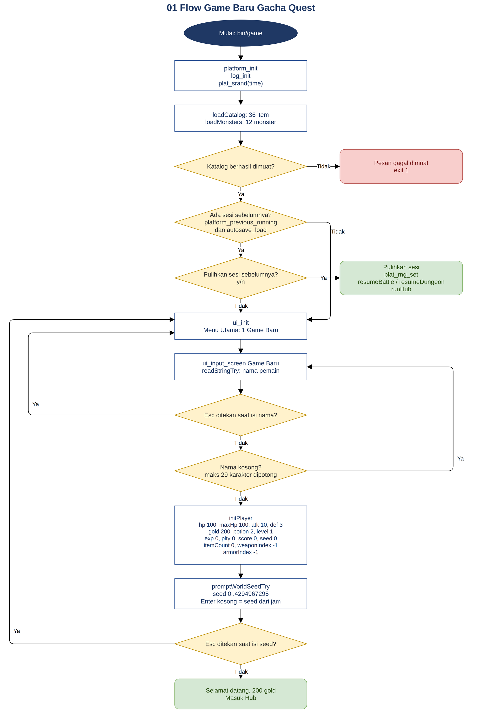 |
| 2 | Load Game | [Draw.io](docs/diagrams/02-load-game.drawio) | 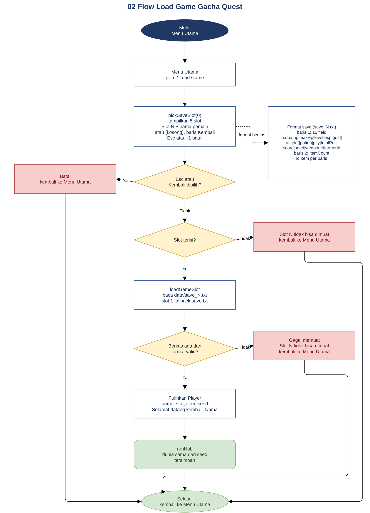 |
| 3 | Leaderboard | [Draw.io](docs/diagrams/03-leaderboard.drawio) | 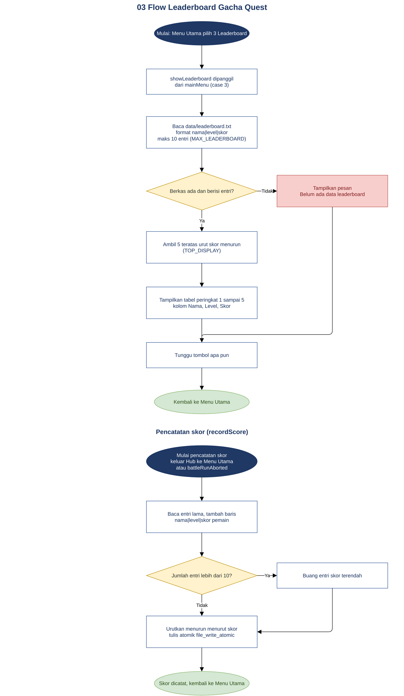 |
| 4 | Keluar | [Draw.io](docs/diagrams/04-keluar.drawio) | 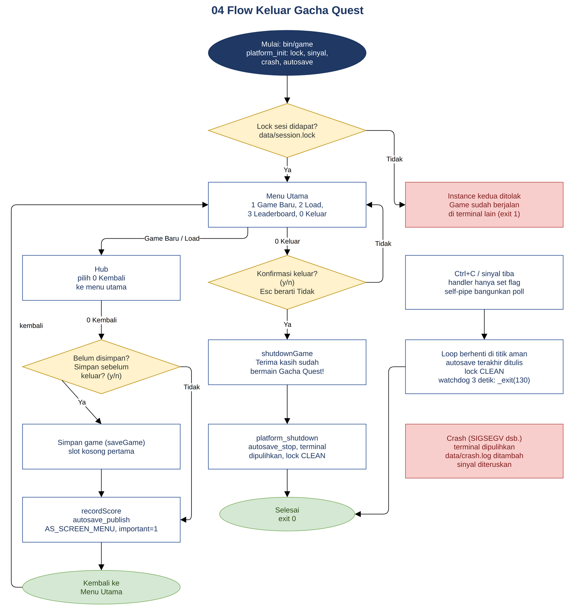 |
| 5 | Battle | [Draw.io](docs/diagrams/05-battle.drawio) | 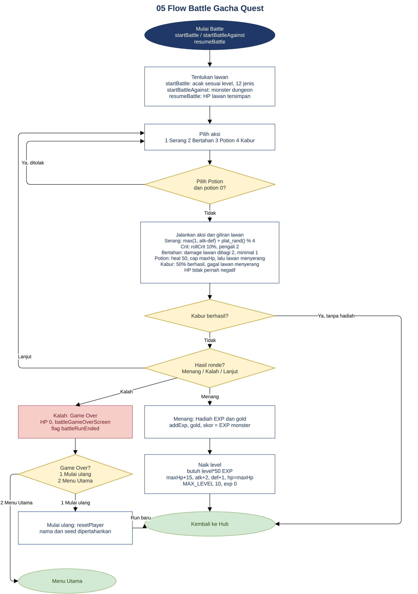 |
| 6 | Gacha | [Draw.io](docs/diagrams/06-gacha.drawio) | 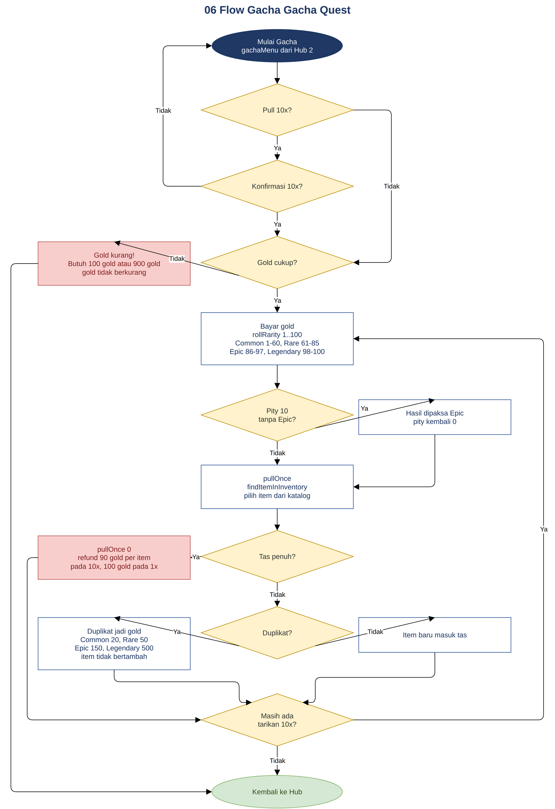 |
| 7 | Inventory | [Draw.io](docs/diagrams/07-inventory.drawio) | 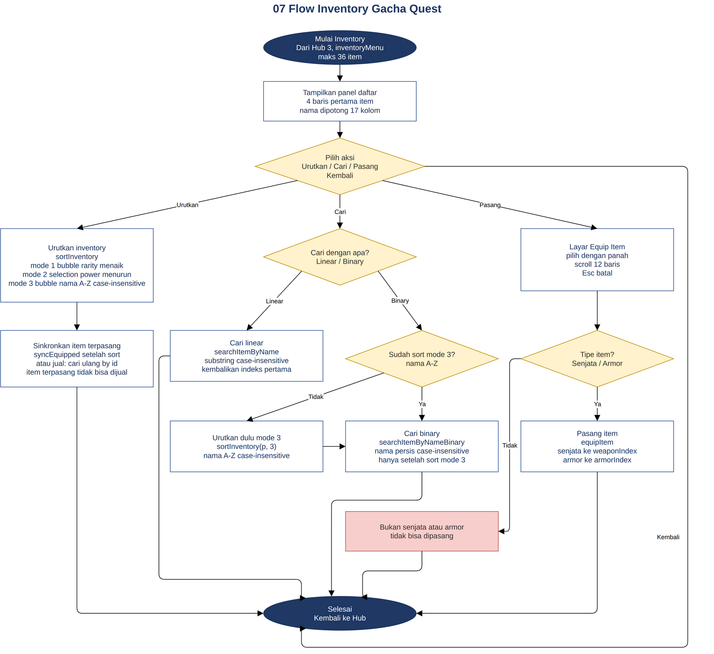 |
| 8 | Shop | [Draw.io](docs/diagrams/08-shop.drawio) | 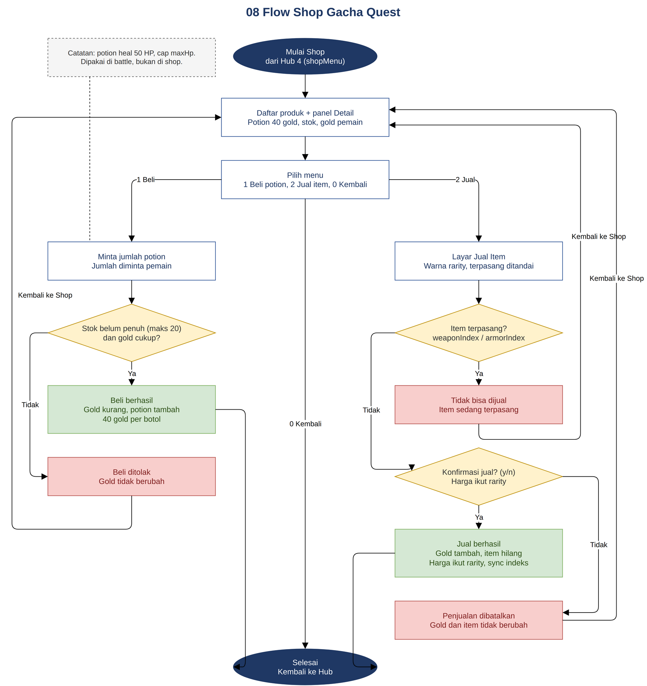 |
| 9 | Dungeon | [Draw.io](docs/diagrams/09-dungeon.drawio) | 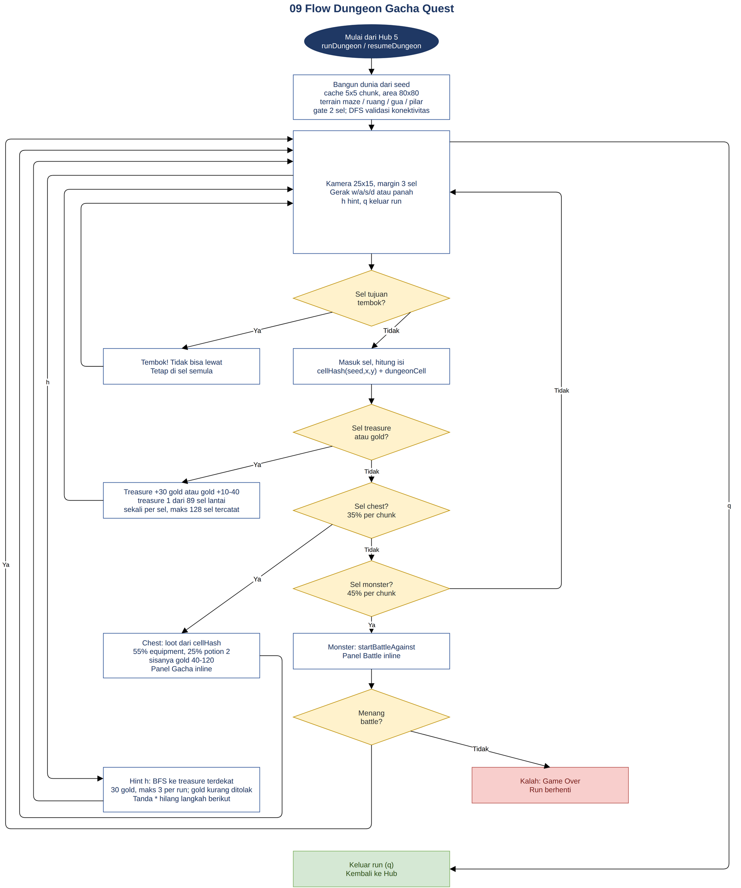 |
| 10 | Status | [Draw.io](docs/diagrams/10-status.drawio) | 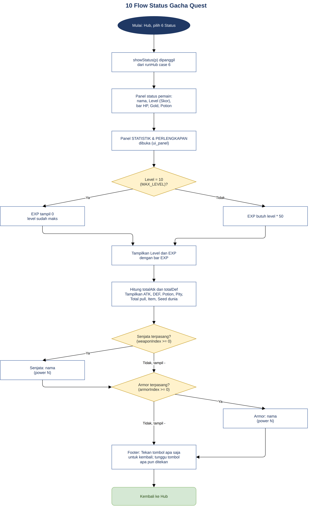 |
| 11 | Simpan | [Draw.io](docs/diagrams/11-simpan.drawio) | 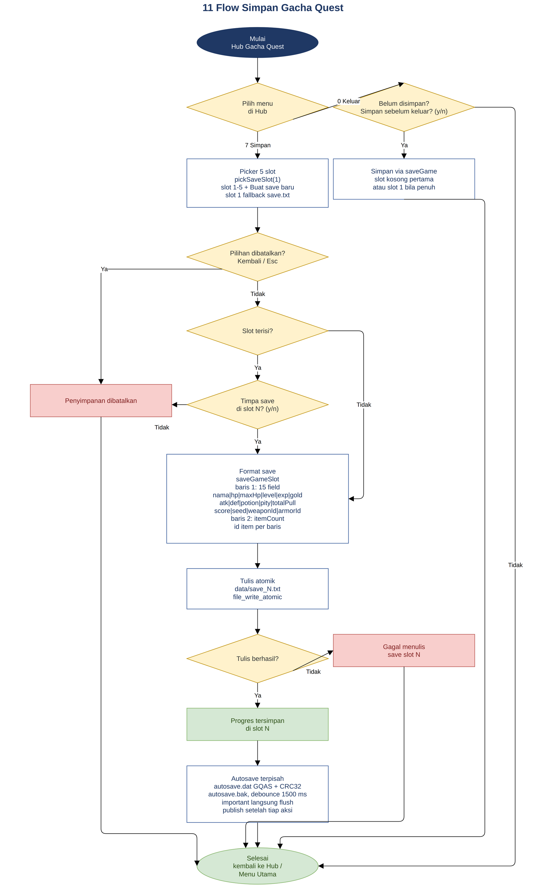 |


Arsip diagram besar lama masih ada di [docs/flow-diagram.mmd](docs/flow-diagram.mmd).

## Daftar Isi

1. [PRD](docs/PRD.md) — kebutuhan produk, aturan game, kontrak modul, kriteria penerimaan.
2. [Project Overview](docs/PROJECT-OVERVIEW.md) — gambaran singkat, struktur repo target, alur runtime.
3. [Pembagian Tugas](docs/PEMBAGIAN-TUGAS.md) — lima peran, fase, tag, jadwal, definition of done.
4. [Panduan 0 — Git dan Kompilasi](docs/panduan-0-git-dan-kompilasi.md) — menyiapkan lingkungan, repo, dan build pertama. Panduan ini juga memuat alur Git per anggota (branch per modul, PR ke `dev`, dan tag) di bagian "Alur Git per Anggota".
5. [Panduan P1 — Scaffold, UI, dan Integrasi](docs/panduan-P1-scaffold-ui.md)
6. [Panduan P2 — Dungeon](docs/panduan-P2-dungeon.md)
7. [Panduan P3 — Battle dan Player](docs/panduan-P3-battle-player.md)
8. [Panduan P4 — Gacha dan Inventory](docs/panduan-P4-gacha-inventory.md)
9. [Panduan P5 — Shop dan Storage](docs/panduan-P5-shop-storage.md)
10. [Spesifikasi Tampilan](docs/UI.md): arsitektur lapisan UI, geometri, palet, dan isi tiap layar.
11. [Tangkapan Layar](docs/screens.md): 18 gambar target sebagai pembanding tampilan akhir.
12. [Keputusan Perilaku](docs/KEPUTUSAN-PERILAKU.md): hal yang tidak diatur PRD dan wajib disamakan.

Urutannya disengaja. Baca PRD lebih dulu karena di sana semua angka dan kontrak
fungsi ditetapkan. Sesudah itu panduan peran bisa dibaca sesuai tanggung jawab
masing-masing, sedangkan Panduan 0 dipakai bersama saat menyiapkan mesin kerja.

Setiap panduan peran punya bagian `## Jalur Mahir` untuk anggota yang sudah nyaman
C, git, terminal, dan testing. Bagian itu memuat urutan ringkas, bukti diterima,
dan jebakan. Jalur pemula di bawahnya tetap lengkap.

## Prasyarat

- **GCC** dengan dukungan C11 (di Windows, pakai MSYS2 atau Git Bash yang membawa
  toolchain `gcc`).
- **Make** untuk menjalankan target `all`, `start`, `test`, dan `clean`.
- **Git** untuk branch per fitur, commit, dan pull request.
- **Terminal minimal 50 kolom × 20 baris.** Di bawah ukuran itu, tampilan UI
  menolak berjalan dan meminta terminal diperbesar.

Cek ketiganya sebelum mulai:

```sh
gcc --version
make --version
git --version
```

## Mulai Cepat

Clone repo ini, masuk ke foldernya, lalu build dan jalankan:

```sh
git clone https://github.com/yayayapluto/GachaQuest.git
cd GachaQuest
make
make start
make test
```

Perintah `make` baru berhasil setelah P1 menulis `Makefile` dan `main.c`. Keduanya
dikerjakan pada Milestone 1–2 di [Panduan P1](docs/panduan-P1-scaffold-ui.md), jadi
sebelum tahap itu selesai cukup clone repo dan baca dokumennya.

Repo itu publik: clone dan baca bebas, tetapi push butuh izin tulis dari pemilik.
Cara mengatur remote, minta izin, push branch, dan membuka PR ada di bagian
[Push ke Repo Bersama](docs/panduan-0-git-dan-kompilasi.md#push-ke-repo-bersama)
pada Panduan 0.

## Alur Kerja per Anggota

Dari clone sampai pull request, urutannya begini:

1. `git clone https://github.com/yayayapluto/GachaQuest.git` lalu `cd GachaQuest`.
2. `git checkout -b feat/<modul>` — satu branch per modul, misalnya `feat/dungeon`.
3. Baca `docs/PRD.md` bagian 6, 7, dan 8 minimal sekali: aturan game, kontrak
   fungsi per modul, dan format file. Semua angka yang kamu butuhkan ada di sana.
4. Buka panduan peranmu sendiri, ikuti `## Langkah Kerja` berurutan, dan cek
   setiap blok `Expected` sebelum lanjut ke langkah berikutnya.
5. Setelah P1 menyelesaikan Milestone 1–2, jalankan `make` lalu `make test`
   sebelum commit. Keduanya harus bersih dari warning dan kegagalan.
6. Commit dengan format `feat(<modul>): ...`, `git push`, buka PR ke `dev`, lalu
   tunggu review P1.

## Panduan dan Lampiran untuk Bertanya ke AI

Saat meminta bantuan AI, lampirkan panduan peranmu plus header modul yang
dipakai. Jangan melampirkan seluruh repo.

| Anggota | Panduan yang dilampirkan | Header pendukung | Skenario yang harus lulus |
|---|---|---|---|
| P1 | [Panduan P1](docs/panduan-P1-scaffold-ui.md) | `src/core/config.h`, `src/util/util.h`, `src/platform/*.h` | S01, S02, S17, dan `make test` semua lulus |
| P2 | [Panduan P2](docs/panduan-P2-dungeon.md) | `src/dungeon/dungeon.h`, `src/core/config.h` | S12, S13, S14, S16 |
| P3 | [Panduan P3](docs/panduan-P3-battle-player.md) | `src/player/player.h`, `src/battle/battle.h` | S03, S04, S18 |
| P4 | [Panduan P4](docs/panduan-P4-gacha-inventory.md) | `src/gacha/gacha.h`, `src/inventory/inventory.h` | S05, S08, S09 |
| P5 | [Panduan P5](docs/panduan-P5-shop-storage.md) | `src/storage/storage.h`, `src/shop/shop.h` | S09, S10, S11, S15 |

Setiap panduan peran sudah memuat `## Konteks untuk AI` berisi angka pasti,
prototipe fungsi, format file, larangan, dan skenario uji. Jadi cukup lampirkan
panduan itu, header pendukung di atas, dan file yang sedang kamu kerjakan.
Konteksnya sudah lengkap tanpa seluruh repo, dan jawaban AI tidak akan mengarang
aturan yang tidak ada di kontrak. Untuk urusan git, kompilasi, dan build, ikut
lampirkan juga `docs/panduan-0-git-dan-kompilasi.md`; dokumen itu berlaku untuk
semua anggota.

## Struktur Awal Itu Spesifikasi, Bukan Solusi

Root repo sengaja hanya berisi tiga hal:

- `src/**/*.h` — 23 header berisi konstanta, struct, dan prototipe fungsi
  publik seluruh modul. Ini janji antarmuka, bukan implementasi.
- `data/item.txt` dan `data/monster.txt` — katalog contoh berformat
  pipa yang harus dibaca program.
- `tests/` — skrip `run_tests.sh`, seluruh driver `t_*`, dan input skenario
  S01–S18 sebagai acuan penerimaan.

Tidak ada satu pun berkas `src/**/*.c` di dalam repo ini, dan tidak ada `Makefile`
di root. Implementasi, Makefile, serta `main.c` adalah pekerjaan tim. Header dipakai
apa adanya; kalau sebuah fungsi butuh tanda tangan berbeda, perubahan diusulkan ke
P1 supaya semua pemilik modul menyesuaikan diri pada versi yang sama.

## Peran Sekilas

| Kode | Level | Peran | File milik |
|---|---|---|---|
| P1 | mahir | UI, platform, integrator | `Makefile`, `main.c`, `src/core/config.h`, `src/util/*`, `src/ui/*`, `src/platform/*`, `README.md` |
| P2 | mahir | Dungeon | `src/dungeon/dungeon.c`, `src/dungeon/dungeon.h`, `tests/t_dungeon.c` |
| P3 | awam | Battle dan player | `src/player/*`, `src/battle/*` |
| P4 | awam | Gacha dan inventory | `src/gacha/*`, `src/inventory/*` |
| P5 | awam | Shop, storage, leaderboard | `src/shop/*`, `src/storage/*` |

Aturan mainnya: satu file satu pemilik. P3 sampai P5 tidak menyentuh `src/ui`,
tidak memanggil `printf` untuk layar, dan tidak memakai `rand()` melainkan
`plat_rand()`. Rincian fase dan cara review ada di
[Pembagian Tugas](docs/PEMBAGIAN-TUGAS.md).

## Menjalankan Pengujian

Dari root repo:

```sh
sh tests/run_tests.sh
```

Skrip ini mengompilasi game dan seluruh driver `t_*`, lalu menjalankan 18 skenario
(S01–S18). Setiap baris hasil menandai lulus atau gagal. Pengujian butuh `gcc` dan
`make` yang sudah terpasang, jadi selesaikan dulu langkah pada
[Panduan 0](docs/panduan-0-git-dan-kompilasi.md).

Setelah game berjalan, cek paritas tampilan dan alur:

```sh
sh tests/parity.sh
```

Skrip membandingkan output `bin/game` dengan `tests/out_golden.txt`. Hasil
`PARITAS OK` berarti alur demo dan teks layar sama dengan target.

## Checklist Demo

Sebelum presentasi, pastikan dua belas layar berikut bisa ditunjukkan tanpa error:

1. **Menu Utama** — Game Baru, Load Game, Leaderboard, Keluar.
2. **Game Baru** — input nama (maksimal 29 karakter) dan seed dunia.
3. **Load Game** — lima slot, slot kosong ditandai, data rusak menghasilkan pesan.
4. **Leaderboard** — sepuluh entri tersimpan, lima teratas ditampilkan urut skor.
5. **Hub** — pintu masuk ke Battle, Dungeon, Gacha, Inventory, Shop, dan Status.
6. **Battle** — menu Serang, Bertahan, Potion, Kabur beserta log pertarungan.
7. **Gacha** — pull 1x (100 gold) dan 10x (900 gold), pity, duplikat.
8. **Inventory** — urutkan, cari item, pasang senjata dan armor.
9. **Shop** — beli potion dan jual item dengan konfirmasi.
10. **Status** — HP, level, EXP, gold, serangan, pertahanan, daftar item terpasang.
11. **Dungeon** — gerak, kamera, treasure, hint, chest, dan monster.
12. **Game Over** — Mulai ulang (reset run) atau kembali ke menu utama.

Skenario penerimaan di PRD §11 memetakan tiap layar ke ID uji, jadi kegagalan
demo biasanya bisa dilacak ke satu baris `run_tests.sh` tertentu.

## Repo Ini Mandiri

Seluruh aturan, angka, format file, dan daftar fungsi publik ditulis ulang di
dalam paket ini. Tidak ada tautan keluar, tidak ada rujukan ke proyek lain, dan
tidak ada bagian yang bergantung pada berkas di luar folder ini. Kalau sebuah
keputusan belum tercantum di PRD, keputusan itu belum menjadi bagian kontrak:
diskusikan dengan P1 dan perbarui dokumennya lebih dulu sebelum menulis kode.
